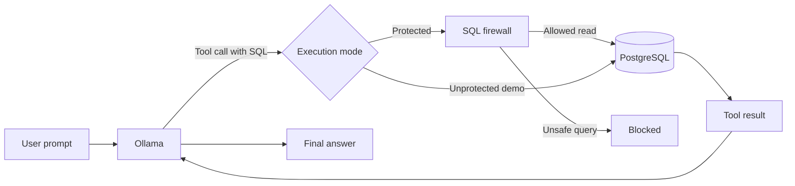

<div align="center">

# 🛡️ LLM Firewalls: An Introduction

### Inspect model-generated SQL before it reaches your database

A small, local proof of concept built with **Ollama**, **Python**, and
**PostgreSQL**.

[](https://www.python.org/)
[](https://www.postgresql.org/)
[](https://docs.docker.com/compose/)
[](https://ollama.com/)

[Overview](#overview) · [Demo](#video-walkthrough) · [Quick start](#quick-start) · [Architecture](#how-it-works) · [Security notes](#security-notes)

</div>

> [!IMPORTANT]
> This repository is an educational demonstration, not a production-ready
> security control. Run the unprotected mode only against the included local,
> fictional data.

## Overview

LLMs can generate useful database queries—but executing that SQL without an
application-controlled safety boundary is risky. This project demonstrates a
simple boundary that inspects every model-generated query before PostgreSQL can
execute it.

| Mode | SQL path | Behavior |
| --- | --- | --- |
| 🟢 **Protected** (default) | Ollama → firewall → PostgreSQL | Allows read-oriented queries and blocks modifying or administrative SQL |
| 🟠 **Unprotected** (demo only) | Ollama → PostgreSQL | Executes model-generated SQL directly to make the risk visible |

The application—not the model—selects the execution mode. The model cannot
bypass the firewall through a tool argument.

## Video walkthrough

<div align="center">

[](https://youtu.be/oZbMvaFHqyw)

*Click the image to watch the introduction.*

</div>

## Quick start

### Prerequisites

Before you begin, make sure you have:

- [Python 3.10+](https://www.python.org/downloads/)
- [Docker](https://docs.docker.com/get-docker/) with Docker Compose
- [Ollama](https://ollama.com/)

Run all commands from the repository root.

### 1. Create the Python environment

```bash
python -m venv .venv
source .venv/bin/activate
pip install -r requirments.txt
```

If the virtual environment already exists, activate it and install any missing
dependencies.

### 2. Configure PostgreSQL

Create a local environment file:

```bash
cp configurations/.env.example configurations/.env
```

Open `configurations/.env` and replace the example password with a local
password of your choice. This file is ignored by Git.

Start PostgreSQL and check that it is healthy:

```bash
docker compose -f configurations/docker-compose.yml up -d
docker compose -f configurations/docker-compose.yml ps
```

The first startup creates a `customers` table and fills it with fictional sample
data from `configurations/postgres/init/`.

<details>
<summary><strong>Inspect the sample data directly</strong></summary>

```bash
docker compose -f configurations/docker-compose.yml exec database \
  psql -U firewall_user -d firewall_bank
```

Then run:

```sql
SELECT * FROM customers;
```

Type `\q` to leave the PostgreSQL shell.

</details>

### 3. Start Ollama

Download the default tool-capable model:

```bash
ollama pull qwen3.6
```

If Ollama is not already running as a background service, start it in a separate
terminal:

```bash
ollama serve
```

The application connects to Ollama at `http://localhost:11434/api/chat`.

### 4. Run the protected demo

The firewall is enabled by default:

```bash
python main.py
```

To use another locally installed, tool-capable model:

```bash
python main.py --model qwen3
```

Try asking the assistant to read the customer data, then ask it to modify a
record. Queries beginning with `SELECT`, `WITH`, `SHOW`, or `EXPLAIN` can pass;
keywords such as `INSERT`, `UPDATE`, `DELETE`, and `DROP` are blocked.

### 5. Compare with unprotected mode

```bash
python main.py --disable-firewall
```

This deliberately allows model-generated SQL to modify the demonstration
database. Use it only with the included local data.

Type `exit` or `quit` in either mode to end the conversation.

### 6. Stop the database

```bash
docker compose -f configurations/docker-compose.yml down
```

PostgreSQL data remains in a Docker volume. The initialization scripts run only
when that volume is first created.

## How it works



1. `main.py` selects protected or unprotected mode and starts the interactive
   chat.
2. `llm_integrations/ollama_based_integration.py` sends the conversation and
   the database tool definition to Ollama.
3. When Ollama calls `execute_database_query`, the generated SQL is passed to
   `llm_integrations/database_layer.py`.
4. In protected mode, `firewall/firewall_class.py` validates the SQL before the
   database layer can execute it.
5. The database result—or the firewall error—is returned to Ollama as a tool
   message so it can produce a final answer.

## Project structure

```text
.
├── configurations/
│   ├── docker-compose.yml       # Local PostgreSQL service
│   └── postgres/init/           # Schema and fictional sample data
├── firewall/
│   └── firewall_class.py        # SQL inspection rules
├── llm_integrations/
│   ├── database_layer.py        # Protected and direct execution paths
│   └── ollama_based_integration.py
├── main.py                      # Command-line entry point
└── requirments.txt              # Python dependencies
```

## Security notes

- The firewall is intentionally basic: it uses allow-list and deny-list regular
  expressions, not a full SQL parser.
- Protected mode allows statements beginning with `SELECT`, `WITH`, `SHOW`, or
  `EXPLAIN` after rejecting known modifying and administrative keywords.
- Unprotected mode exists only to demonstrate the danger of trusting generated
  SQL.
- The database binds to `127.0.0.1`, and the included records are fictional.

> [!CAUTION]
> Do not treat this proof of concept as a replacement for least-privilege
> database roles, read-only transactions, query parsing, auditing, or other
> production security controls.
